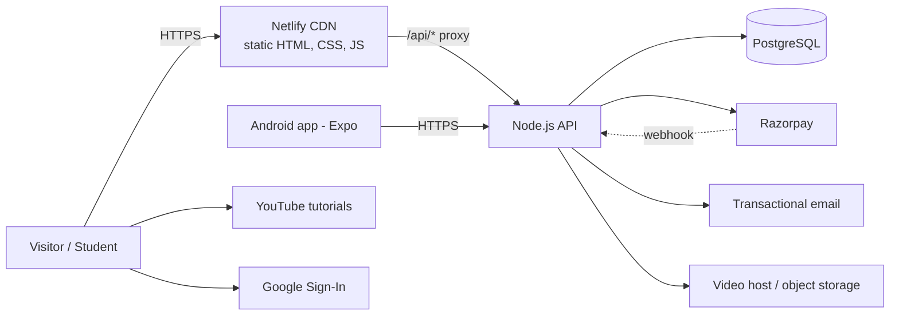

# Architecture — VLSI Insights Website

| | |
|---|---|
| **Version** | 1.1 (draft) — revised after reviewing the public repo `Amol257/vlsi-insights` |
| **Date** | 2026-09-20 |
| **Status legend** | **Observed** = seen on the live site · **Target** = recommended design · **Verify** = unknown, check the codebase |

---

## 1. System context



---

## 2. Current state (Observed)

Sources: live pages (Home, Programs, Front-End Software) and the public repo `Amol257/vlsi-insights` (`netlify.toml` read in full; root file listing; README snippet). Not readable: `js/`, `css/`, `_redirects`, login/cart/blog pages.

| Concern | Observed | **Verify** |
|---|---|---|
| Hosting | Netlify | Which folder and branch Netlify actually builds |
| Repo layout | Three descriptions disagree: the README snippet says deploy from `VLSI Insights/Website` with `publish = "."`; `netlify.toml` says `base = "frontend"`, `publish = "."` and puts pages under `/pages/`; the GitHub root listing is flat (HTML at top level + `css/`, `images/`, `js/`, `_redirects`, `netlify.toml`, one commit) | Whether the public repo matches what is deployed |
| Front end | Multi-page static HTML/CSS/JS. `css/global.css` (resets, colour tokens), `css/navbar.css`, `css/footer.css`, `js/main.js` (nav drawer, accordions, cart synchronisation per README). Header/footer markup repeated on every page | Any build step; JS inventory |
| Routing | `netlify.toml` serves **clean URLs as 200 rewrites** to `/pages/<name>.html`: `/cart`, `/programs`, `/login`, `/front-end-software` (+ `/software`), `/about-company`, `/about-owner`, `/testimonials`, `/vlsi-designs`, `/soc-verification`, `/embedded-systems`, `/ai-models`, `/web-development`, `/technical-training`, `/marketing-solutions` (+ `/marketing-solution`). Aliases: `/about` → `/about-company` (302), `/solutions` → `/marketing-solutions` (302), `/contact` → `/index.html#contact` (302), `/technical-blogs` and `/technical-blogs.html` → blog (301). Asset rewrites map `/pages/{css,js,images}/*` and `/blog/{css,js,images}/*` to the root folders, which is why relative asset paths keep working at those depths | A root `_redirects` file also exists (Netlify processes it **before** `netlify.toml`); root-level `.html` duplicates of `/pages/*` |
| Blog | `/blog` and `/blogs` → `/pages/blog.html`; `/blog/:slug` and `/post` → `/pages/post.html` — one post template, so post content is presumably loaded at runtime | Where posts come from (JSON, CMS, DB, service) |
| Auth | Sign in (username/email + password), Register, Forgot password, Google login, "Keep me signed in", `?redirect=`. Routes `/auth/callback` (→ `/pages/auth-callback.html`) and `/complete-profile` (→ `/pages/complete-profile.html`) imply an OAuth-style callback and a profile step after sign-up | Provider (e.g. Supabase, Firebase, custom), token storage, what complete-profile collects |
| Cart | "Added to cart!" toast, header badge, `/cart`; add-to-cart requires sign-in | Local vs server; what "cart synchronisation" means |
| Payments | Not visible in fetched pages | Whether Razorpay is wired |
| Forms | 4 forms (enquiry, application, curriculum PDF, software support) with on-page success states | Delivery mechanism, spam protection |
| Gated content | EDA lab page shows "Sign in to access" | Whether gating is enforced server-side |
| Caching | `/css/*`, `/js/*`, `/images/*` get `Cache-Control: public, max-age=31536000, immutable`; HTML gets `max-age=0, must-revalidate`. The file comment says CSS/JS are fingerprinted, but the README names them without hashes (`global.css`, `main.js`) | Whether asset links carry a version query string |
| Security headers | None in `netlify.toml` | Whether set in the Netlify UI |
| Third parties | YouTube tutorials, WhatsApp deep links (`wa.me`, `api.whatsapp.com`), Google login | Analytics, fonts, CDNs |

**Implication for this plan:** login, profile completion, cart sync and dynamic blog posts suggest a backend or hosted service **may already exist**. The Phase 1 API in §3 must not blindly duplicate it — see AD-9 and task T-020.

---

## 3. Target architecture

**Principle:** keep the fast static front end; add one small, well-secured API that becomes the single source of truth for programs, users, payments, enrolments, leads and content. The Android app consumes the same API.

| Layer | Choice | Why |
|---|---|---|
| Front end | Static HTML/CSS/vanilla JS on Netlify. Add a build-time include step (small Node script, Eleventy or Astro) **only** to remove duplicated header/footer/head markup, emitting the same `/pages/*.html` files | Minimal migration risk; fixes duplication |
| API | Node.js (current LTS) + Express, TypeScript, Zod for validation | Matches the planned app backend; widely supported by AI coding tools |
| Database | PostgreSQL (managed: Neon, Supabase, Railway or similar) | Relational fit for users/orders/enrolments |
| ORM / migrations | Prisma (schema derived from §6 DDL) | Typed queries, versioned migrations |
| Auth | Email+password (argon2id) + Google ID-token sign-in; short-lived JWT access token + rotating refresh token | Works for web and mobile |
| Payments | Razorpay Orders API + Checkout + webhooks | Client already has an account |
| Email | Transactional provider (Brevo, Resend or SES) | Receipts, resets, lead notifications |
| Video | Signed-URL video host (Bunny Stream, Cloudflare Stream or Vimeo Pro) — **not** unlisted YouTube for paid content | Backend-gated access |
| Files | S3-compatible object storage (Cloudflare R2 / S3) for PDFs, brochures, downloads | Signed URLs for enrolled-only files |
| Monitoring | Sentry (front + API), uptime monitor on `/api/health`, Netlify analytics or GA4 | Detect breakage early |

> **Adopt vs replace (AD-9):** the table below is the target *if no suitable auth/blog/cart backend exists today*. If one does, keep it, verify its tokens in the API instead of issuing your own, and skip the corresponding tasks.

**Hosting the API:** any managed Node host with a persistent process (Render, Railway, Fly.io). Netlify Functions are acceptable for Phase 1 lead/webhook endpoints but not recommended as the long-term home of a shared web + mobile API.

---

## 4. URL & routing strategy

**Decision (proposed): keep the existing scheme.** Clean URLs (`/programs`) are served by 200 rewrites to `/pages/<name>.html` in `netlify.toml`. Do **not** replace that file. Fix links, canonicals and caching around it.

Rules:
1. Every internal link, canonical tag, `og:url`, sitemap entry and WhatsApp/share link uses the **clean URL** (`/programs`, not `/programs.html`, not `/pages/programs`). Today Home links to `/vlsi-designs.html`, inner pages link to `/pages/vlsi-designs`, and Programs declares `canonical: programs.html`.
2. Keep the existing `/pages/{css,js,images}/*` and `/blog/{css,js,images}/*` asset rewrites until every page uses root-relative asset paths (`/css/…`). Only then may they be removed.
3. Keep **one** redirect source. `_redirects` and `netlify.toml` both exist; `_redirects` wins on conflict. Move everything into `netlify.toml` and delete `_redirects` (T-017) after reading its content.
4. Do not add a catch-all `/pages/:slug` redirect — it would collide with the asset rewrites. If legacy direct hits (`/programs.html`, `/pages/programs.html`) need to be consolidated, add **one explicit 301 per page** and test with `curl -IL`.

### 4.1 Edits to make in the existing `netlify.toml`

**A. Replace the existing `/css/*` and `/js/*` header blocks.** The current `immutable` one-year cache is only safe with hashed filenames; without them, returning visitors keep stale CSS/JS after a deploy.

```toml
# Until assets are content-hashed (or linked with ?v=<build>), always revalidate.
[[headers]]
  for = "/css/*"
  [headers.values]
    Cache-Control = "public, max-age=0, must-revalidate"

[[headers]]
  for = "/js/*"
  [headers.values]
    Cache-Control = "public, max-age=0, must-revalidate"
```
Once filenames are hashed (e.g. `global.3f9a1c.css`) or every link carries a changing `?v=`, the `immutable` one-year rule can return. Keep `/images/*` as is (images rarely change under the same name; rename on change).

**B. Add security headers** (none exist today):

```toml
[[headers]]
  for = "/*"
  [headers.values]
    Strict-Transport-Security = "max-age=31536000; includeSubDomains"
    X-Content-Type-Options = "nosniff"
    X-Frame-Options = "DENY"
    Referrer-Policy = "strict-origin-when-cross-origin"
    Permissions-Policy = "camera=(), microphone=(), geolocation=()"
```
`X-Frame-Options = "DENY"` is safe only if no page is embedded in an iframe on another site — check first.

**C. Add the API proxy** only when the Phase 1 API exists:

```toml
[[redirects]]
  from = "/api/*"
  to = "https://<API_ORIGIN>/:splat"
  status = 200
  force = true
```

**D. Optional, per page, after T-002:**

```toml
[[redirects]]
  from = "/programs.html"
  to = "/programs"
  status = 301
  force = true
```
Repeat for each page that has a root-level `.html` file. Verify `curl -IL https://vlsi-insights.netlify.app/programs.html` ends at `/programs` with no loop.

Notes:
- **[Verify]** the existing `/contact` → `/index.html#contact` (302) and other 302 aliases; switch to 301 once final.
- Add a **Content-Security-Policy** in report-only mode first. Origins to allow-list: `checkout.razorpay.com`, `api.razorpay.com`, `accounts.google.com`, `www.youtube.com` / `www.youtube-nocookie.com`, the analytics host, the video host, and any auth provider domain found in T-020.
- Add `X-Robots-Tag: noindex` for the `*.netlify.app` domain once production is live.

---

## 5. Repository layout

**Keep the existing structure** and add to it. The folder Netlify builds is **[Verify]** (`frontend/` per `netlify.toml`; README says `VLSI Insights/Website`; the public root is flat). Confirm in T-001, then use that name below.

```
<repo root>
├─ <frontend folder>/          # what Netlify publishes (confirm name in T-001)
│  ├─ index.html
│  ├─ pages/                   # programs, login, cart, service pages, post, auth-callback, complete-profile …
│  ├─ css/                     # global.css (tokens), navbar.css, footer.css [+ page CSS]
│  ├─ js/                      # main.js [+ api.js, auth.js, cart.js, forms.js — added over time]
│  ├─ images/
│  └─ 404.html
├─ server/                     # NEW in Phase 1 (only if AD-9 = build our own API)
│  ├─ src/{routes,services,middleware,db,config}
│  ├─ prisma/                  # schema + migrations
│  └─ tests/
├─ docs/
│  ├─ project/                 # PRD, Architecture, Design, Rules, Tasks, Memory (these six files)
│  └─ …                        # existing specs if present: design.md, structure.md, components.md, content.md, prompt.md
├─ netlify.toml                # the single source of redirects and headers
└─ .github/workflows/ci.yml
```

**File-name collision:** on Windows and macOS `Design.md` and `design.md` are the same file. Keep the six planning docs in `docs/project/` (or merge them into the existing docs) — never copy them next to an existing file whose name differs only by case.

**Shared partials (AD-2):** header/footer/head markup is repeated on every page. A build-time include step is still recommended, but it must fit the existing `base` / `publish` settings and the `/pages/` layout. Simplest first step: a small Node script or Eleventy/Astro config that emits the same `/pages/*.html` files.

---

## 6. Data model (PostgreSQL)

Amounts are stored in **paise** (integer) to match Razorpay.

```sql
CREATE EXTENSION IF NOT EXISTS citext;

CREATE TYPE user_role         AS ENUM ('student', 'instructor', 'admin');
CREATE TYPE order_status      AS ENUM ('created', 'paid', 'failed', 'refunded');
CREATE TYPE enrollment_status AS ENUM ('active', 'completed', 'cancelled');
CREATE TYPE lead_status       AS ENUM ('new', 'contacted', 'qualified', 'won', 'lost');
CREATE TYPE resource_access   AS ENUM ('public', 'enrolled');
CREATE TYPE lesson_type       AS ENUM ('video', 'pdf', 'link', 'quiz');

-- Users -------------------------------------------------------------
CREATE TABLE users (
  id                uuid PRIMARY KEY DEFAULT gen_random_uuid(),
  name              text        NOT NULL,
  email             citext      NOT NULL UNIQUE,
  phone             text,
  password_hash     text,                          -- null for Google-only accounts
  google_sub        text UNIQUE,
  role              user_role   NOT NULL DEFAULT 'student',
  email_verified_at timestamptz,
  created_at        timestamptz NOT NULL DEFAULT now(),
  updated_at        timestamptz NOT NULL DEFAULT now()
);

CREATE TABLE refresh_tokens (
  id          uuid PRIMARY KEY DEFAULT gen_random_uuid(),
  user_id     uuid NOT NULL REFERENCES users(id) ON DELETE CASCADE,
  token_hash  text NOT NULL UNIQUE,
  expires_at  timestamptz NOT NULL,
  revoked_at  timestamptz,
  created_at  timestamptz NOT NULL DEFAULT now()
);

CREATE TABLE password_resets (
  id          uuid PRIMARY KEY DEFAULT gen_random_uuid(),
  user_id     uuid NOT NULL REFERENCES users(id) ON DELETE CASCADE,
  token_hash  text NOT NULL UNIQUE,
  expires_at  timestamptz NOT NULL,
  used_at     timestamptz
);

-- Catalog -----------------------------------------------------------
CREATE TABLE programs (
  id             uuid PRIMARY KEY DEFAULT gen_random_uuid(),
  slug           text NOT NULL UNIQUE,
  title          text NOT NULL,
  category       text NOT NULL,                    -- e.g. Beginners, Job-Oriented, Advance, FPGA, Embedded
  duration_label text NOT NULL,                    -- e.g. '4 Months'
  fee_paise      integer NOT NULL CHECK (fee_paise >= 0),
  prerequisites  text,
  syllabus       jsonb NOT NULL DEFAULT '[]',      -- [{module, topics[]}]
  brochure_url   text,
  is_active      boolean NOT NULL DEFAULT true,
  sort_order     integer NOT NULL DEFAULT 0,
  created_at     timestamptz NOT NULL DEFAULT now(),
  updated_at     timestamptz NOT NULL DEFAULT now()
);

CREATE TABLE batches (
  id          uuid PRIMARY KEY DEFAULT gen_random_uuid(),
  program_id  uuid NOT NULL REFERENCES programs(id) ON DELETE CASCADE,
  starts_on   date NOT NULL,
  enroll_by   date,
  seats_total integer NOT NULL CHECK (seats_total > 0),
  seats_taken integer NOT NULL DEFAULT 0 CHECK (seats_taken >= 0),
  is_open     boolean NOT NULL DEFAULT true
);

-- Commerce ----------------------------------------------------------
CREATE TABLE cart_items (
  user_id    uuid NOT NULL REFERENCES users(id)    ON DELETE CASCADE,
  program_id uuid NOT NULL REFERENCES programs(id) ON DELETE CASCADE,
  batch_id   uuid REFERENCES batches(id),
  added_at   timestamptz NOT NULL DEFAULT now(),
  PRIMARY KEY (user_id, program_id)
);

CREATE TABLE orders (
  id                uuid PRIMARY KEY DEFAULT gen_random_uuid(),
  user_id           uuid NOT NULL REFERENCES users(id),
  status            order_status NOT NULL DEFAULT 'created',
  amount_paise      integer NOT NULL CHECK (amount_paise >= 0),
  currency          char(3) NOT NULL DEFAULT 'INR',
  razorpay_order_id text UNIQUE,
  created_at        timestamptz NOT NULL DEFAULT now(),
  paid_at           timestamptz
);

CREATE TABLE order_items (
  order_id     uuid NOT NULL REFERENCES orders(id)   ON DELETE CASCADE,
  program_id   uuid NOT NULL REFERENCES programs(id),
  batch_id     uuid REFERENCES batches(id),
  price_paise  integer NOT NULL,                   -- price snapshot at purchase time
  PRIMARY KEY (order_id, program_id)
);

CREATE TABLE payments (
  id                   uuid PRIMARY KEY DEFAULT gen_random_uuid(),
  order_id             uuid NOT NULL REFERENCES orders(id),
  razorpay_payment_id  text NOT NULL UNIQUE,
  status               text NOT NULL,
  method               text,
  amount_paise         integer NOT NULL,
  raw                  jsonb,
  created_at           timestamptz NOT NULL DEFAULT now()
);

CREATE TABLE webhook_events (                      -- idempotency for Razorpay webhooks
  event_id    text PRIMARY KEY,                    -- x-razorpay-event-id header
  event_type  text NOT NULL,
  payload     jsonb NOT NULL,
  received_at timestamptz NOT NULL DEFAULT now()
);

CREATE TABLE enrollments (
  id          uuid PRIMARY KEY DEFAULT gen_random_uuid(),
  user_id     uuid NOT NULL REFERENCES users(id),
  program_id  uuid NOT NULL REFERENCES programs(id),
  batch_id    uuid REFERENCES batches(id),
  order_id    uuid REFERENCES orders(id),          -- null for manual enrolment
  status      enrollment_status NOT NULL DEFAULT 'active',
  enrolled_at timestamptz NOT NULL DEFAULT now(),
  UNIQUE (user_id, program_id)
);

-- Learning content (Phase 2) ---------------------------------------
CREATE TABLE modules (
  id         uuid PRIMARY KEY DEFAULT gen_random_uuid(),
  program_id uuid NOT NULL REFERENCES programs(id) ON DELETE CASCADE,
  title      text NOT NULL,
  position   integer NOT NULL
);

CREATE TABLE lessons (
  id           uuid PRIMARY KEY DEFAULT gen_random_uuid(),
  module_id    uuid NOT NULL REFERENCES modules(id) ON DELETE CASCADE,
  title        text NOT NULL,
  type         lesson_type NOT NULL,
  video_ref    text,                               -- id at the video host, never a public URL
  file_key     text,                               -- object-storage key for pdf
  external_url text,
  duration_sec integer,
  is_preview   boolean NOT NULL DEFAULT false,     -- viewable without enrolment
  position     integer NOT NULL
);

CREATE TABLE lesson_progress (
  user_id      uuid NOT NULL REFERENCES users(id)   ON DELETE CASCADE,
  lesson_id    uuid NOT NULL REFERENCES lessons(id) ON DELETE CASCADE,
  completed_at timestamptz,
  last_position_sec integer NOT NULL DEFAULT 0,
  PRIMARY KEY (user_id, lesson_id)
);

CREATE TABLE resources (
  id         uuid PRIMARY KEY DEFAULT gen_random_uuid(),
  title      text NOT NULL,
  kind       text NOT NULL,                        -- e.g. tool, pdf, link
  file_key   text,
  url        text,
  access     resource_access NOT NULL DEFAULT 'enrolled',
  program_id uuid REFERENCES programs(id),         -- null = any enrolled student
  created_at timestamptz NOT NULL DEFAULT now()
);

-- Marketing content -------------------------------------------------
CREATE TABLE leads (
  id           uuid PRIMARY KEY DEFAULT gen_random_uuid(),
  source       text NOT NULL,                      -- home_enquiry | program_application | curriculum_download | software_support
  name         text NOT NULL,
  email        citext NOT NULL,
  phone        text NOT NULL,
  program_id   uuid REFERENCES programs(id),
  message      text,
  meta         jsonb NOT NULL DEFAULT '{}',        -- tool, OS, role, institution, utm_*
  consent_at   timestamptz NOT NULL,
  status       lead_status NOT NULL DEFAULT 'new',
  created_at   timestamptz NOT NULL DEFAULT now()
);

CREATE TABLE blog_posts (
  id           uuid PRIMARY KEY DEFAULT gen_random_uuid(),
  slug         text NOT NULL UNIQUE,
  title        text NOT NULL,
  excerpt      text,
  body_md      text NOT NULL,
  cover_url    text,
  tags         text[] NOT NULL DEFAULT '{}',
  status       text NOT NULL DEFAULT 'draft' CHECK (status IN ('draft', 'published')),
  published_at timestamptz
);

CREATE TABLE testimonials (
  id            uuid PRIMARY KEY DEFAULT gen_random_uuid(),
  person_name   text NOT NULL,
  role_title    text NOT NULL,
  company       text,
  batch_label   text,
  quote         text NOT NULL,
  consent_ref   text NOT NULL,                     -- where written consent is stored
  is_published  boolean NOT NULL DEFAULT false
);

CREATE TABLE site_stats (
  key          text PRIMARY KEY,                   -- e.g. students_trained
  value        text NOT NULL,
  evidence_ref text NOT NULL,                      -- dated source document
  as_of        date NOT NULL
);

CREATE INDEX idx_enrollments_user ON enrollments(user_id);
CREATE INDEX idx_orders_user      ON orders(user_id);
CREATE INDEX idx_leads_created    ON leads(created_at DESC);
CREATE INDEX idx_lessons_module   ON lessons(module_id, position);
```

---

## 7. API surface (REST, JSON)

Base path `/api`. Success: `{ "data": … }`. Error: `{ "error": { "code": "string", "message": "string", "details": {} } }`. All inputs validated with Zod.

| Area | Method & path | Auth | Notes |
|---|---|---|---|
| Health | `GET /health` | — | Uptime monitor |
| Auth | `POST /auth/register` | — | name, email, password, phone |
| | `POST /auth/login` | — | email/username + password |
| | `POST /auth/google` | — | verify Google ID token server-side |
| | `POST /auth/refresh` | cookie / body | rotates refresh token |
| | `POST /auth/logout` | user | revokes refresh token |
| | `POST /auth/forgot-password` · `POST /auth/reset-password` | — | always return 200 to avoid account enumeration |
| | `GET /me` | user | profile |
| Catalog | `GET /programs` · `GET /programs/:slug` · `GET /programs/:slug/batches` | — | filter `?category=` |
| Cart | `GET /cart` · `POST /cart/items` · `DELETE /cart/items/:programId` | user | |
| Checkout | `POST /checkout` | user | creates `orders` row + Razorpay order; amount from DB |
| | `POST /checkout/verify` | user | verifies Razorpay signature; idempotent |
| | `POST /webhooks/razorpay` | signature | source of truth for payment state |
| Student | `GET /me/enrollments` · `GET /me/courses/:slug` | user | modules + lessons |
| | `GET /lessons/:id/playback` | enrolled | short-lived signed URL |
| | `POST /lessons/:id/progress` | enrolled | |
| Resources | `GET /resources` | optional | public always; `enrolled` only if enrolled |
| | `GET /resources/:id/download` | enrolled | signed URL |
| Leads | `POST /leads` | — | rate-limited + CAPTCHA |
| Content | `GET /posts` · `GET /posts/:slug` · `GET /testimonials` · `GET /stats` | — | |
| Admin | `/admin/programs`, `/admin/batches`, `/admin/posts`, `/admin/leads`, `/admin/enrollments` | admin | CRUD + CSV export |

---

## 8. Key flows

### 8.1 Authentication
1. `POST /auth/login` → verify argon2id hash → issue **access JWT (15 min)** in the response body and a **refresh token** (30 days) in an `HttpOnly; Secure; SameSite=Lax` cookie (web) or secure storage (mobile).
2. Front end keeps the access token in memory only; on 401 it calls `/auth/refresh` once, then retries.
3. Refresh tokens are stored hashed and **rotated on every use**; reuse of a revoked token revokes the whole family.
4. Google: client obtains an ID token → `POST /auth/google` → server verifies signature, audience (`GOOGLE_CLIENT_ID`) and `email_verified` → upserts user by `google_sub` / email.
5. `?redirect=` values are validated against an allow-list of same-origin paths.
6. Keep the existing routes: `/auth/callback` (provider redirect lands here, exchanges the code, then goes to the `redirect` target) and `/complete-profile` (collects required fields missing after social sign-up, e.g. phone; **[Verify]** what it collects today). Require a complete profile before first purchase.

### 8.2 Payment (Razorpay)
1. `POST /checkout`: load cart → compute total from `programs.fee_paise` → insert `orders` (`created`) + `order_items` → call Razorpay `orders.create({ amount, currency: 'INR', receipt: order.id })` → store `razorpay_order_id` → return `{ orderId, razorpayOrderId, amount, keyId }`.
2. Client opens Razorpay Checkout with `order_id` and, on success, posts `razorpay_order_id`, `razorpay_payment_id`, `razorpay_signature` to `/checkout/verify`.
3. Server verifies `HMAC_SHA256(razorpay_order_id + "|" + razorpay_payment_id, RAZORPAY_KEY_SECRET)` equals the signature (constant-time compare).
4. Webhook `payment.captured` (verify `X-Razorpay-Signature` against the raw body with `RAZORPAY_WEBHOOK_SECRET`; dedupe on `x-razorpay-event-id` via `webhook_events`).
5. On verified capture, in **one DB transaction**: mark order `paid`, insert `payments`, create `enrollments`, increment `batches.seats_taken`, clear cart items, enqueue receipt email.
6. Enrolment is granted by step 5 only — never by the client redirect alone.

### 8.3 Gated content (EDA lab, resources, lessons)
- Every gated endpoint checks **server-side**: valid access token → active `enrollments` row (for the relevant program, or any program for the EDA lab).
- Static gated pages render a shell; protected data/links are fetched from the API after the check. Do not put protected URLs in HTML, JS bundles or `localStorage`.
- Video and file downloads use signed URLs that expire in ≤ 15 minutes.

### 8.4 Lead pipeline
`form → POST /leads → validate + CAPTCHA + rate limit → insert leads → email info@vlsiinsights.com (+ auto-reply to the sender) → optional webhook to a CRM / WhatsApp automation`. Interim option: keep the current mechanism and add a Netlify Forms fallback until the API is live.

---

## 9. Environments & CI/CD

| Env | Front end | API / DB | Purpose |
|---|---|---|---|
| Local | `netlify dev` / static server | local Postgres (Docker) | Development |
| Preview | Netlify deploy previews per PR | staging API + staging DB, Razorpay **test** keys | Review, QA |
| Production | Netlify (`main`) at vlsiinsights.com | prod API + prod DB, Razorpay **live** keys | Live |

CI (GitHub Actions) on every PR: install → lint → typecheck → unit tests → HTML validation → Lighthouse CI (perf ≥ 90, a11y ≥ 95, SEO ≥ 95) → build. Deploy on merge to `main`. DB migrations run as a separate, reviewed step.

### Environment variables (server)

```
NODE_ENV=
PORT=
DATABASE_URL=
CORS_ORIGINS=https://vlsiinsights.com,https://vlsi-insights.netlify.app
JWT_ACCESS_SECRET=
JWT_REFRESH_SECRET=
GOOGLE_CLIENT_ID=
RAZORPAY_KEY_ID=
RAZORPAY_KEY_SECRET=
RAZORPAY_WEBHOOK_SECRET=
EMAIL_PROVIDER_API_KEY=
EMAIL_FROM=
LEAD_NOTIFY_TO=info@vlsiinsights.com
CAPTCHA_SECRET=
STORAGE_BUCKET= STORAGE_ACCESS_KEY= STORAGE_SECRET_KEY= STORAGE_ENDPOINT=
VIDEO_HOST_API_KEY=
SENTRY_DSN=
```
Only `RAZORPAY_KEY_ID` and `GOOGLE_CLIENT_ID` may be exposed to the browser. Validate all variables at boot with Zod and crash on missing values.

---

## 10. Security checklist

- Passwords: argon2id, min 8 chars, breached-password check, rate-limited login (per IP + per account).
- Sessions: short access token, rotating refresh token, logout revokes.
- Authorization: role + enrolment checks in middleware, never in the UI alone.
- Input: schema validation on every route; parameterised queries only.
- Payments: server-computed amounts, signature verification, idempotent webhooks, raw-body parsing on the webhook route.
- Transport/headers: HTTPS, HSTS, CSP, no inline event handlers once CSP is enforced.
- CORS: explicit origin allow-list; credentials only for those origins.
- Secrets: env vars only; rotate on any leak; separate test/live keys.
- Uploads/files: private bucket, signed URLs, content-type checks.
- Logging: no passwords, tokens, card data or full payloads with PII in logs.
- Backups: daily automated DB backup, restore tested quarterly.

---

## 11. Observability

- `GET /api/health` (DB ping) monitored every minute.
- Sentry on front end and API; alert on new issue and error-rate spike.
- Structured JSON logs with request id; log payment state transitions.
- Product events (see PRD FR-8.4) to analytics.

---

## 12. Architecture decisions

| ID | Decision | Status | Trade-off |
|---|---|---|---|
| AD-1 | Keep static front end on Netlify | **Decided (2026-09-20)** | High performance, instant previews, zero server maintenance |
| AD-2 | Build-time partials for head/header/footer via `scripts/build-partials.js` | **Decided (2026-09-20)** | Zero runtime SSR overhead, eliminates 16-page header/footer drift |
| AD-3 | Hybrid Decoupled Architecture: Supabase (Auth/RLS/Content) + Express API (Payments/Webhooks/Gating) | **Decided (2026-09-20)** | Clean separation of concerns; shared by web and Android app |
| AD-4 | Keep existing clean-URL rewrites to `/pages/*.html`; clean links/canonicals; one redirect source (`netlify.toml`) | **Decided (2026-09-20)** | `_redirects` retired; canonical search indexing preserved |
| AD-5 | Single source of truth data: `programs.json`, `site-stats.json`, `testimonials.json` + SQL seeds | **Decided (2026-09-20)** | DB and static UI always stay in 100% price/data alignment |
| AD-6 | Signed-URL video host for paid content | **Open** — Cloudflare Stream or Bunny.net in Phase 2 | Cost vs control |
| AD-7 | Email provider | **Open** — Resend / Brevo in Phase 1 | Deliverability vs price |
| AD-8 | GST on invoices | **Open** — "₹XX,XXX (Incl. 18% GST)" recommended | Legal/tax |
| AD-9 | Hybrid Supabase Auth + Express API: Supabase handles auth & student profiles; Express handles Razorpay checkout, HMAC signature verification, and EDA lab gating | **Decided (2026-09-20)** | Avoids redundant auth layer; secures financial & lab workflows |
| AD-10 | CSS/JS cache policy: `max-age=0, must-revalidate` on CSS/JS; 1-yr immutable on images | **Decided (2026-09-20)** | Immediate stylesheet invalidation on deploys without breaking static media caching |

Record every future decision here with a date and rationale.
