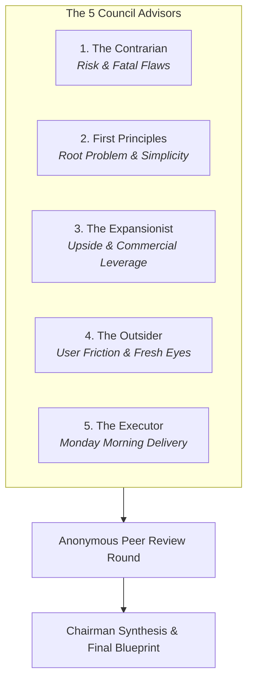

# Project Implementation Roadmap & Architecture Blueprint
## Changes, Additions, and Execution Plan (LLM Council Review)

| | |
|---|---|
| **Document** | Comprehensive Changes & Additions Master Plan |
| **Date** | 2026-09-20 |
| **Methodology** | LLM Council (Karpathy 5-Advisor Multi-Perspective Review + Chairman Synthesis) |
| **Inputs Analyzed** | `Architecture.md`, `Design.md`, `Memory.md`, `PRD.md`, `Rules.md`, `Tasks.md`, and active codebase |
| **Status** | **Ready for Review & Execution** |

---

## 1. Executive Summary & Council Verdict

An exhaustive, multi-perspective LLM Council session was conducted to analyze the path forward for the **VLSI Insights platform**. The council evaluated the six core project planning documents alongside the live repository state—specifically addressing the unresolved architectural decision **AD-9** (Supabase vs custom Express/Postgres API), current frontend assets, and backend implementation files.

### The Chairman's Verdict

> **The Council unanimously concludes: DO NOT build a redundant, second-layer custom database/auth backend.** 
> The codebase already contains configured Supabase client code (`frontend/js/supabase.js`) and a structured Node/Express service (`backend/src/`) tailored for Razorpay payments and database interactions. 
> 
> The optimal, lowest-risk, highest-velocity strategy is a **Hybrid Decoupled Architecture**:
> 1. **Data & Auth Core (Supabase):** PostgreSQL with Row Level Security (RLS), PKCE social/email authentication, and user profiles.
> 2. **Financial & Secure Gateway (Node.js/Express API):** Razorpay order creation, HMAC webhook verification, server-side transactional enrollment provisioning, and rate-limited lead ingestion.
> 3. **High-Performance Static Frontend (Netlify):** Multi-page static architecture with build-time shared partials, design tokens, clean URLs, and client-side SDK integration for responsive user interactions.

---

## 2. The LLM Council Deliberation

To avoid single-model bias, the project roadmap was evaluated by five independent personas representing contrasting engineering, business, and operational philosophies.



### 2.1 Advisor Perspectives

#### Advisor 1: The Contrarian (Risk & Attack Surfaces)
* **The "Dual Backend" Disaster:** Having both client-side Supabase calls and a custom Express API will lead to authorization split-brain unless clear boundaries are set. If client-side code directly queries Supabase without strict RLS, students will bypass payments and grant themselves course enrollments.
* **The Webhook HMAC Trap:** In `backend/src/app.js`, `express.json()` is parsed before route mounting. Razorpay webhook HMAC signatures **must** be validated against the unparsed, raw request buffer. If this is parsed into a JSON object first, signature verification fails in production, silently dropping paid orders.
* **The Cache Invalidation Trap:** `netlify.toml` sends `Cache-Control: immutable, max-age=31536000` on unhashed filenames (`global.css`, `landing-redesign.css`). Returning visitors will be stuck with stale styling for a year unless asset versioning (`?v=BUILD_ID`) is strictly enforced immediately.
* **Legal Compliance Liability:** Promising "100% placement" or displaying unverified placement packages exposes the company to Indian Consumer Protection (misleading advertising) liabilities.

#### Advisor 2: The First Principles Thinker (Essential Architecture)
* **What problem are we actually solving?** A training company needs to: (a) build authority, (b) capture student/corporate leads, (c) collect program fees via Razorpay, and (d) gate high-value EDA lab material.
* **Strip the abstraction:** Do not waste weeks writing custom Express authentication routers, password reset flows, and Prisma migrations when Supabase already provides battle-tested Postgres auth, email templates, and OAuth. Use Express exclusively as a secure server-side orchestration gateway for Razorpay and sensitive transactional notifications.

#### Advisor 3: The Expansionist (Value & Commercial Upside)
* **The Missing Engine (Individual Course Pages):** Currently, courses live inside modal popups and brochure downloads. This loses massive organic search traffic. Each course needs an indexable canonical route (`/programs/soc-verification`, `/programs/rtl-design`) with `Course` JSON-LD schema, complete syllabus roadmaps, and instant checkout triggers.
* **Automated Instant Lead SLA:** The site currently has conflicting response promises ("<4 hrs", "<24 hrs", "one business day"). Replace this with an instant automated WhatsApp + Email brochure trigger via webhook within 30 seconds of form submission.
* **Corporate B2B Funnel:** Corporate training and college placement cell tracks command 10x higher deal sizes than individual students. Separate B2C student journeys from B2B enterprise proposals.

#### Advisor 4: The Outsider (Cognitive Load & User UX)
* **Pricing Opacity:** The site lists prices for 5 programs, but the flagship "6-Month VLSI Mastery" course has no fee displayed. Prospective students find hidden pricing suspicious. Display the fee or provide a clear "Apply for Scholarship / Sponsored Seat" callout.
* **Cognitive Dissonance on Gated Lab:** The "Front-End Software" page asks users to sign in, but doesn't explain that signing in alone is insufficient—they must have an active paid enrollment. This creates frustration when a signed-in user still encounters locked doors.

#### Advisor 5: The Executor (Sequence & Tactical Delivery)
* **Cut the scope bloat:** Do not touch the Android app (Phase 3) or custom LMS video streaming players (Phase 2) until Phase 0 hygiene and Phase 1 payments are bulletproof.
* **Deliver in 4 strict, non-breaking batches:**
  1. Hygiene, cache headers, shared chrome, and design tokens.
  2. Single source of truth data reconciliation (programs, stats, testimonials).
  3. Hardened Supabase Auth + Express Razorpay checkout & webhook.
  4. Server-gated EDA lab and student enrollment verification.

### 2.2 Peer Review Findings
* **Where the Council Agrees:** Unifying the program catalog into a single data source is non-negotiable. Building a duplicate Prisma auth layer when Supabase exists is wasteful. Razorpay webhook verification must use raw body buffers.
* **Where the Council Clashed:** The Contrarian argued for shutting down all direct client-side Supabase queries and routing 100% of traffic through Express. The First Principles Thinker and Executor demonstrated that Supabase client SDK with strict Postgres RLS is industry-standard, faster, and eliminates API latency for read queries.
* **The Council Resolution:** Read operations (catalog, public posts, reviews) and user session auth flow directly through Supabase client with RLS. All financial transactions, order creation, webhook fulfillment, and role promotions flow exclusively through the authenticated Express backend.

---

## 3. Core Architectural Decisions (AD Resolutions)

| Decision ID | Topic | Council Verdict | Implementation Choice |
| :--- | :--- | :--- | :--- |
| **AD-1** | Hosting | **Keep Netlify** | High-performance Edge CDN, instant preview deploys. |
| **AD-2** | Shared Chrome | **Build-Time Partials** | Lightweight Node.js build script injecting `<header>`, `<footer>`, `<head>`, and floating WhatsApp button into all 16 pages. Eliminates code drift. |
| **AD-3 / AD-9** | Backend Architecture | **Hybrid Supabase + Express** | **Supabase:** Auth, Profiles, Content, RLS.<br/>**Express (`backend/`):** Razorpay Orders, Webhook HMAC, Secure Email Dispatch, Server Gating. |
| **AD-4** | Routing & Links | **Strict Clean URLs** | All internal links convert to `/programs`, `/about-company`, etc. Remove `.html` extensions. Preserve existing Netlify 200 rewrites. |
| **AD-5** | Data Single Source | **JSON Data Seed** | `programs.json`, `site-stats.json`, `testimonials.json` drive both static page rendering and database seeding. |
| **AD-6** | Paid Video Hosting | **Deferred to Phase 2** | Use Cloudflare Stream or Bunny.net for paid video; YouTube strictly for public walkthroughs. |
| **AD-7** | Transactional Email | **Resend / Brevo** | Integrated in Express backend for receipt delivery and lead alerts. |
| **AD-8** | Pricing & Taxes | **GST Inclusive Display** | Display prices as "₹XX,XXX (Incl. 18% GST)" to maintain consumer trust and legal compliance. |
| **AD-10** | Asset Caching | **Versioned Query Params** | Link CSS/JS with `?v=YYYYMMDD_BUILD` and configure `max-age=0, must-revalidate` in `netlify.toml`. |

---

## 4. Exact File-by-File Blueprint: What Will Be Changed & Added

```
VLSI Insights Repository
├── backend/
│   ├── src/
│   │   ├── app.js                          [MODIFY: Raw webhook body parser, routes]
│   │   ├── config/
│   │   │   ├── env.js                      [MODIFY: Strict Zod environment schema]
│   │   │   ├── razorpay.js                 [KEEP / VERIFY: Key initialization]
│   │   │   └── supabase.js                 [KEEP / VERIFY: Service role client]
│   │   ├── controllers/
│   │   │   ├── paymentController.js        [MODIFY: Server-side price calculation, idempotency]
│   │   │   ├── contactController.js        [MODIFY: Honeypot, validation, email alert]
│   │   │   └── enrollmentController.js     [MODIFY: Gated access verification]
│   │   ├── middleware/
│   │   │   ├── authMiddleware.js           [MODIFY: Supabase JWT validation]
│   │   │   └── rawBody.js                  [NEW: Preserve raw buffer for Razorpay webhooks]
│   │   ├── routes/
│   │   │   └── paymentRoutes.js            [MODIFY: Mount raw body webhook route]
│   │   └── services/
│   │       └── razorpayService.js          [MODIFY: HMAC SHA256 timing-safe verification]
│   ├── database/
│   │   ├── schema.sql                      [KEEP / EXTEND: Supabase tables & RLS policies]
│   │   └── seeds/
│   │       └── catalog_seed.sql            [NEW: Canonical programs & stats seed]
│   └── package.json                        [MODIFY: Add zod, resend]
├── frontend/
│   ├── index.html                          [MODIFY: Root-relative assets, shared partial tags]
│   ├── 404.html                            [MODIFY: Clean asset paths, dark mode parity]
│   ├── netlify.toml                        [MODIFY: Security headers, cache revalidation, API proxy]
│   ├── _redirects                          [DELETE / RETIRE: Consolidated into netlify.toml]
│   ├── css/
│   │   ├── global.css                      [MODIFY: Formalize design tokens, contrast pairs]
│   │   ├── navbar.css                      [MODIFY: Clean URL links, accessible focus rings]
│   │   ├── footer.css                      [MODIFY: Clean URL links, remove hardcoded years]
│   │   ├── landing-redesign.css            [MODIFY: Token integration, responsive clamp]
│   │   └── apple-motion.css                [MODIFY: Token integration, reduced motion support]
│   ├── js/
│   │   ├── main.js                         [MODIFY: Shared partials init, remove inline onclicks]
│   │   ├── supabase.js                     [MODIFY: Session management, profile gate]
│   │   ├── checkout.js                     [NEW: Razorpay frontend modal integration]
│   │   └── api.js                          [NEW: Unified backend API fetch wrapper]
│   ├── data/
│   │   ├── programs.json                   [NEW: Canonical program catalog]
│   │   ├── site-stats.json                 [NEW: Documented metric claims with sources]
│   │   └── testimonials.json               [NEW: Verified alumni reviews with consent flags]
│   ├── partials/
│   │   ├── head-meta.html                  [NEW: Shared SEO, favicon, OG metadata]
│   │   ├── header-nav.html                 [NEW: Canonical desktop mega-menu & mobile drawer]
│   │   ├── footer.html                     [NEW: Canonical sitemap & contact footer]
│   │   └── floating-whatsapp.html          [NEW: Standardized WhatsApp action button]
│   └── pages/
│       ├── programs.html                   [MODIFY: Render from programs.json, clean links]
│       ├── front-end-software.html         [MODIFY: Server-side enrollment verification gate]
│       ├── cart.html                       [MODIFY: Server-backed cart state, checkout button]
│       ├── login.html                      [MODIFY: Accessible forms, 8-char min password]
│       ├── complete-profile.html           [MODIFY: Required phone & designation fields]
│       ├── auth-callback.html              [MODIFY: Clean redirect resumption]
│       ├── privacy-policy.html             [NEW: DPDP Act 2023 compliant privacy policy]
│       ├── terms.html                      [NEW: Terms of service & course enrollment terms]
│       └── refund-policy.html              [NEW: Clear cancellation & refund conditions]
├── scripts/
│   ├── build-partials.js                   [NEW: Injects partials into pages at build]
│   └── verify-parity.js                    [NEW: Automated hash comparison across twin repos]
└── docs/
    ├── Architecture.md                     [MODIFY: Document hybrid Supabase+Express resolution]
    ├── Design.md                           [MODIFY: Document extracted token table]
    ├── Memory.md                           [MODIFY: Log AD-9 resolution and session milestones]
    └── Tasks.md                            [MODIFY: Update task statuses for Phase 0 & Phase 1]
```

---

## 5. Detailed Breakdown of Changes

### 5.1 Backend Hardening (`backend/`)

#### 1. [NEW] `backend/src/middleware/rawBody.js`
* **Purpose:** Solves the critical webhook HMAC signature failure identified by the Contrarian.
* **Implementation:** Captures the raw unparsed `Buffer` on incoming POST requests to `/api/payments/webhook` before any JSON transformation occurs.

#### 2. [MODIFY] `backend/src/services/razorpayService.js`
* **Changes:**
  * Implement constant-time string comparison (`crypto.timingSafeEqual`) on webhook signatures to prevent timing attacks.
  * Fetch course pricing **strictly from the database**; never accept `amount` passed from the frontend request payload.

#### 3. [MODIFY] `backend/src/controllers/paymentController.js`
* **Changes:**
  * `createOrder`: Validates user authentication via Supabase JWT, looks up official fee in `programs` table, generates Razorpay order with currency `INR` and integer paise.
  * `handleWebhook`: Listens for `payment.captured`. In a single atomic database transaction: updates payment record, sets enrollment status to `active`, increments enrolled seat counter, and clears user's cart. Idempotent check ensures duplicate webhook deliveries cause no side-effects.

#### 4. [MODIFY] `backend/src/controllers/contactController.js`
* **Changes:**
  * Add honeypot field (`_gotcha`) validation to eliminate spam without user friction.
  * Enforce IP rate-limiting (maximum 5 submissions per 15 minutes).
  * Store lead in Supabase `leads` table with UTM attribution parameters and consent timestamp.

---

### 5.2 Frontend Structural Hygiene (`frontend/`)

#### 1. [NEW] Build-Time Partial Injection (`scripts/build-partials.js`)
* **Purpose:** Solves the 16-page duplication problem (T-003) without introducing runtime SSR overhead or heavy frameworks.
* **Mechanism:** Reads `frontend/partials/*.html` and merges them into target placeholders (`<!-- @include header -->`, etc.) during build/dev execution.

#### 2. [NEW] Single Source of Truth Data Files (`frontend/data/`)
* **`programs.json`:**
  * Defines exact title, slug, duration, category, price (paise), brochure link, and prerequisites for all programs.
  * Eliminates the discrepancy between "11 programs", "10 programs", and the 5 visible brochures.
* **`site-stats.json`:**
  * Single canonical record for: `students_trained: 200+`, `training_tracks: 3`, `corporate_partners: 10+`, `years_experience: 5+`.
  * Every metric contains an `evidence_ref` and `as_of` timestamp.
* **`testimonials.json`:**
  * Unified alumni testimonials dataset with explicit `consent_verified: true` flags.

#### 3. [MODIFY] Netlify Routing & Caching (`frontend/netlify.toml`)
* **Retire `_redirects`:** Move all rewrite logic into `netlify.toml` so a single evaluation engine manages traffic.
* **Fix Caching Headers:**
  ```toml
  [[headers]]
    for = "/css/*"
    [headers.values]
      Cache-Control = "public, max-age=0, must-revalidate"

  [[headers]]
    for = "/js/*"
    [headers.values]
      Cache-Control = "public, max-age=0, must-revalidate"
  ```
* **Enforce Security Headers:** Add HSTS, `X-Content-Type-Options: nosniff`, `Referrer-Policy: strict-origin-when-cross-origin`, and a hardened Content-Security-Policy (CSP) in report-only mode.
* **Add API Proxy:** Route `/api/*` to the active backend instance with `force = true`.

#### 4. [MODIFY] Link & Canonical Sanitization
* Remove all `.html` extensions from internal anchors across all pages:
  - Change `/vlsi-designs.html` &rarr; `/vlsi-designs`
  - Change `/pages/programs.html` &rarr; `/programs`
  - Change `canonical: programs.html` &rarr; `canonical: https://vlsiinsights.com/programs`

#### 5. [NEW] Mandatory Legal Pages (`frontend/pages/`)
* Create `privacy-policy.html` compliant with India's Digital Personal Data Protection Act (DPDP Act, 2023).
* Create `terms.html` and `refund-policy.html` clearly specifying enrollment policies, online lab conduct, and fee rules.

---

### 5.3 Security & Access Control Hardening

#### 1. Server-Gated EDA Lab (`front-end-software.html`)
* **Current Vulnerability:** Gating is checked via client-side JavaScript reading local flags. A user could alter DOM attributes or storage to reveal download links.
* **Fix:**
  - Page shell renders as an open marketing overview showcasing tool capabilities, curriculum scope, and eligibility.
  - Access to EDA Playground credentials, QuestaSim/ModelSim download links, and direct instructor lab queues is guarded by a token-authenticated endpoint (`GET /api/enrollment/verify-lab-access`).
  - If the user does not possess an active paid enrollment in an eligible track, the backend returns HTTP 403 Forbidden with an upgrade trigger. No private software links appear in client JS bundles.

#### 2. Authentication Flow Hardening
* Password minimum length raised from 6 to 8 characters with visual strength meters on `login.html`.
* `?redirect=` query parameter allow-listed to relative same-origin paths only, preventing open-redirect phishing attacks.

---

## 6. What We Are Explicitly NOT Doing (Deferred Scope)

To maintain focus and avoid delivery failure, the council explicitly defers the following items:

1. **NO Custom Prisma/Postgres Auth Replacement:** We will not waste time building email verification servers, password reset token tables, or custom session stores. Supabase handles this natively.
2. **NO Heavy Single Page App (SPA) Framework Migration:** We will not rewrite the site in React, Next.js, or Vue. The vanilla HTML/CSS multi-page architecture is fast, lightweight, SEO-friendly, and operates cleanly on Netlify CDN.
3. **NO Phase 3 Android App Code Yet:** Mobile app development will start only after the web payments and backend API endpoints are certified green in production.
4. **NO Custom Paid Video Player in Phase 0:** Proprietary video hosting (Cloudflare Stream) belongs to Phase 2 (Student LMS). Public YouTube embeds remain strictly for marketing walkthroughs.

---

## 7. Phased Execution Roadmap

```
Batch 1: Hygiene & Config (P0)      ==>  T-001, T-002, T-004, T-014, T-017
Batch 2: Single Source of Truth (P0) ==>  T-005, T-006, T-007, T-008, T-013
Batch 3: Backend & Payments (P0)    ==>  T-020, T-022, T-026, T-027, T-029
Batch 4: Gated Access & Legal (P0)   ==>  T-015, T-030, T-032, T-033
```

### Batch 1: Hygiene, Caching & Routing (Estimated: 2 days)
* [ ] Fix `netlify.toml` caching (`must-revalidate` on CSS/JS).
* [ ] Add security headers (HSTS, nosniff, frame protection).
* [ ] Consolidate all redirects into `netlify.toml` and retire `_redirects`.
* [ ] Sanitize internal links to clean URLs across all 16 pages.
* [ ] Build lightweight partial injection script for shared header/footer.

### Batch 2: Catalog & Content Data Reconciliation (Estimated: 2 days)
* [ ] Create `frontend/data/programs.json`, `site-stats.json`, `testimonials.json`.
* [ ] Render Programs page, filter counts, and modals from canonical JSON.
* [ ] Reconcile stats across all pages (200+ students, 3 tracks, 10+ partners, 5+ years).
* [ ] Select single published response-time promise ("Within 24 business hours").
* [ ] Extract design tokens into `Design.md` and lock contrast compliance.

### Batch 3: Commerce, Auth & Lead Pipeline (Estimated: 3 days)
* [ ] Formalize AD-9: finalize Supabase for Auth/Profiles and Express for API.
* [ ] Mount raw body buffer middleware for Razorpay webhook verification.
* [ ] Wire server-side Razorpay order creation using DB program prices.
* [ ] Build idempotent webhook handler provisioning enrollments on `payment.captured`.
* [ ] Connect all lead capture forms to validated `/api/contact` endpoint with honeypot.

### Batch 4: Gated EDA Lab, Legal & Go-Live (Estimated: 2 days)
* [ ] Implement server-side enrollment check for EDA lab tool access.
* [ ] Publish DPDP-compliant Privacy Policy, Terms, and Refund Policy pages.
* [ ] Execute Playwright test suite: Enquiry submit &rarr; Login &rarr; Cart &rarr; Test Razorpay &rarr; Enrolled Lab Access.
* [ ] Synchronize all modified files to twin repository (`VLSI Insights`) and verify 100% SHA256 parity.

---

## 8. Verification & Acceptance Criteria

Every task must fulfill the following verification gates before being marked complete:

1. **Parity Check:** `node scripts/verify-parity.js` must confirm 0 hash mismatches between `VLSI Insights - Copy` and `VLSI Insights`.
2. **WCAG 2.2 AA Compliance:** Lighthouse accessibility score &ge; 95 on Home, Programs, and Front-End Software pages. Minimum touch targets &ge; 44&times;44px. Text contrast &ge; 4.5:1.
3. **Razorpay Test Matrix:**
   - [ ] Order creation with tampering prevention (client cannot alter fee).
   - [ ] Successful test payment triggers enrollment in database within 3 seconds.
   - [ ] Duplicate webhook delivery is handled idempotently without duplicate records.
   - [ ] Tampered webhook signature receives HTTP 400 and creates no enrollment.
4. **Security Verification:**
   - [ ] `curl -IL https://localhost:8889` displays all mandatory security headers.
   - [ ] Protected EDA download routes return 401/403 for unauthorized requests.
